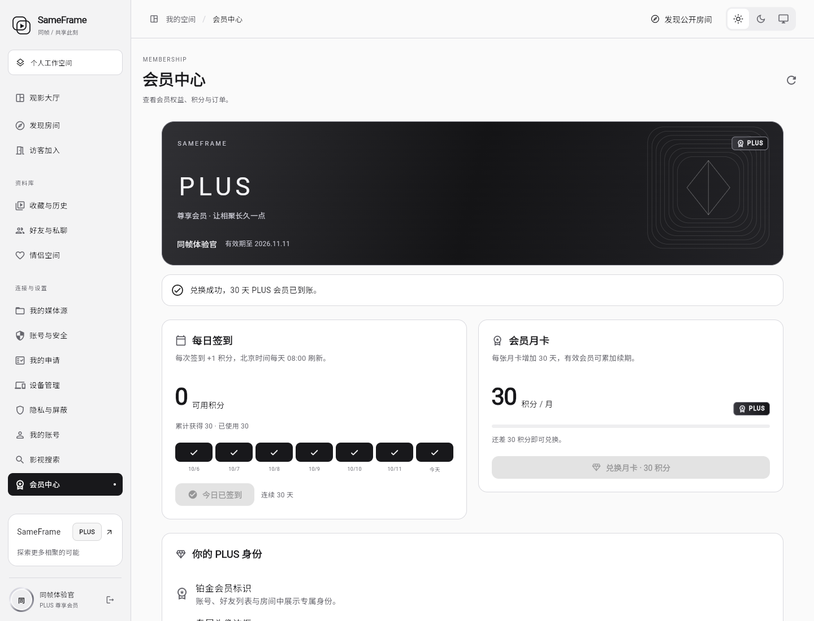
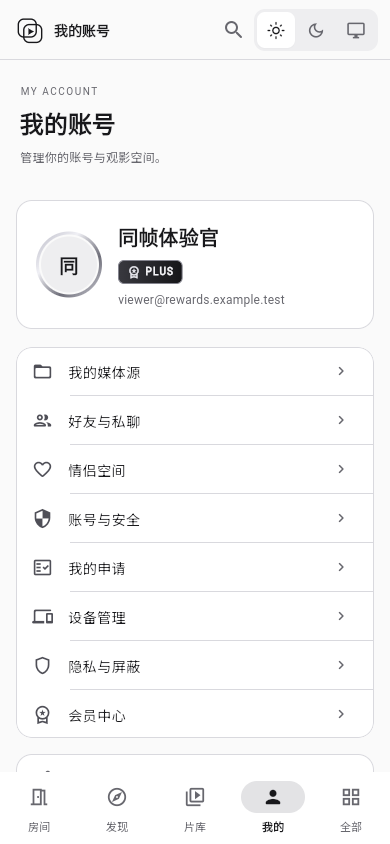

# 会员签到与积分兑换 · 发布记录

已部署：2026-10-12 06:32 UTC（北京时间 14:32）。

- 网站：https://38.76.190.179/
- 本次应用版本：`10e6032dc092f70d67b70abc545175acdd2bae96`。
- 修改前代码：`0b11ee0c1c6464011e8a6a002de095e960954a78`。
- 回滚基线标签：`rollback/pre-membership-rewards-20261012`。
- [本次 CI](https://github.com/kawaiilord/devbox/actions/runs/38211676561)：五项任务全部成功。

## 会员规则

| 项目 | 实际规则 |
| --- | --- |
| 每日签到 | 每天领取 1 积分，重复签到不重复发放 |
| 每日刷新 | 沿用 UTC 日期，即北京时间每天 08:00 |
| 会员月卡 | 30 积分兑换 30 天 PLUS 会员，一个月按 30 天计算 |
| 续期 | 有效会员从原到期时间增加 30 天；非会员或已到期会员从兑换成功时计算 |
| 余额不足 | 不扣分、不开通；界面显示还差多少积分 |
| 长期会员 | 不允许重复兑换月卡，避免浪费积分 |
| 断网重试 | 保存兑换请求，刷新后仍可确认原结果；同一请求只扣一次积分 |

## 新增

1. 服务端固定价格的会员月卡接口、按用户隔离的去重请求和兑换凭据。
2. 签到、可用积分、近 7 天签到状态、兑换进度、确认对话框与成功反馈。
3. 黑白铂金会员卡、PLUS 身份标识和专属头像描边。
4. 账号页、侧栏、好友/私聊资料、房间成员和聊天中的会员身份展示。
5. 房间内会员到期信息定时同步，独立于播放器状态，不重载影片。
6. 新数据库表 `membership_redemptions`；扣分、续期、凭据和流水在同一事务中完成。
7. 仅在本机运行的隔离验收程序，以及可独立执行的部署/回滚工具。
8. 项目规范 `AGENTS.md` 与 `docs/changes/`：后续每轮修改继续记录新增、调整、删除、验证和回滚点。

## 调整

- 会员中心优先展示签到和积分兑换，支付套餐、激活码归入“其他开通方式”。
- 兑换成功后同步会员状态，无需退出后重新登录。
- 当天尚未签到时保留昨天的连续签到天数；真正漏签一天后才归零。
- 签到重复请求返回已有状态；数据库约束保证只产生一次奖励。
- 房间状态广播读取当前会员身份，避免成员变化时丢失标识。
- 订单轮询在失败或页面销毁时停止，显示可重试提示。

## 移除与保留

- 移除用户界面里的“任意兑换天数”输入，统一展示月卡。
- 支付服务未配置时，不展示无法购买的套餐。
- 保留既有积分、签到、订单、激活码、会员期限和旧客户端兑换接口。
- 旧 `SAMEFRAME_POINTS_PER_VIP_DAY` 只控制旧按天接口；当前月卡价格由新接口固定为 30 积分。

## 验证结果

| 检查 | 结果 |
| --- | --- |
| 服务端自动化 | `go test -race ./...` 通过，含 PostgreSQL 18 和 Redis 8 |
| 并发与幂等 | 相同请求 12 次并发重试不重复扣分；10 个不同请求竞争 30 积分只有 1 个成功 |
| 业务边界 | 无积分、有效会员续期、已过期计算、长期会员保护、不同用户请求隔离通过 |
| 会员身份 | 房间状态保留会员标识，到期同步不改变播放事件，通过 |
| 客户端 | Flutter 分析、测试和 Web/Windows/Linux 构建通过 |
| 实际浏览器 | 29 积分签到到 30，兑换后余额 0、累计支出 30、会员增加 30 天 |
| 中断恢复 | 服务端提交后故意丢弃响应，刷新后用同一请求恢复；积分流水只有 1 笔扣分，会员未重复延长 |
| 界面 | 桌面深浅色、账号/好友/房间标识、390 与 320 像素手机宽度通过，无页面脚本错误 |
| 线上核验 | 网页校验值与构建产物相同，`readyz` 中 PostgreSQL/Redis 正常，接口返回 30 积分/30 天和每日 1 积分 |
| 数据核对 | 正式库部署前后积分流水数量相同；兑换测试全部在隔离内存环境完成 |

截图中的“同帧体验官”是隔离验收账号，展示实际签到和兑换后的状态。
生产账号未被测试脚本发放积分或开通会员。

## 界面截图

测试账号实际兑换后的会员中心：



手机上的会员身份与专属头像：



## 备份与回滚

部署前已备份网页、服务端二进制和 PostgreSQL 数据，并保留原运行镜像。
数据库备份已通过 `pg_restore --list` 可读性检查，备份 SHA-256 与回滚镜像可用性检查通过。

- 备份目录：`/opt/sameframe/backups/membership-20261012-063133`。
- 原镜像保留标签：`sameframe-app:before-membership-10e6032`。
- 部署清单：`/opt/sameframe/releases/membership-10e6032/deployment.json`。

先检查回滚文件：

```bash
python3 /opt/sameframe/releases/membership-10e6032/release.py --check-rollback
```

需要撤回本次界面和服务端代码时，在服务器执行：

```bash
python3 /opt/sameframe/releases/membership-10e6032/release.py --rollback
```

正常版本回滚保留新增数据表和上线后的积分、签到及会员权益，不用旧数据库覆盖新用户活动。
数据库备份仅用于另行决定的灾难恢复。生产回滚未实际执行；当前运行的仍是新版。

## 校验值

| 文件 | SHA-256 |
| --- | --- |
| 当前网页 main.dart.js | `7c80201bdf21e5483e3f68096263bc66bf6718453fda8c5da96bca7a7f986758` |
| 当前服务端 | `644cfc1b97b305134b3c71a2be2c6d95ed3c5af37c9fccbb188f68c940648f43` |
| 原服务端 | `c2416f64e0e38ab7b7c2f5a43501254fd0252e19008e4c5455cab0deaad43de9` |
| 网页备份 web.tgz | `7b8a6b06b59b6f3b3fe5a153ecf5e6fd77f4e91fce883ce2434ef6ba399fdcee` |
| 数据库备份 database.dump | `8b7a112e81aafeec27d49156d4d985ab466f8aacaae6e44981389bae923844d6` |

## 开发提交

| 提交 | 内容 |
| --- | --- |
| `b2c3834` | 月卡兑换事务、身份标识、会员中心及持续修改记录规范 |
| `f7aa859` | 隔离验收环境、连续签到规则和接口说明 |
| `2c6084c` | 刷新后恢复待确认兑换、明确失败处理及回滚工具 |
| `d4bc35b` | 房间会员身份与到期同步，不影响播放 |
| `10e6032` | 修正隔离验收账号的设备标识，完成本次构建 |
