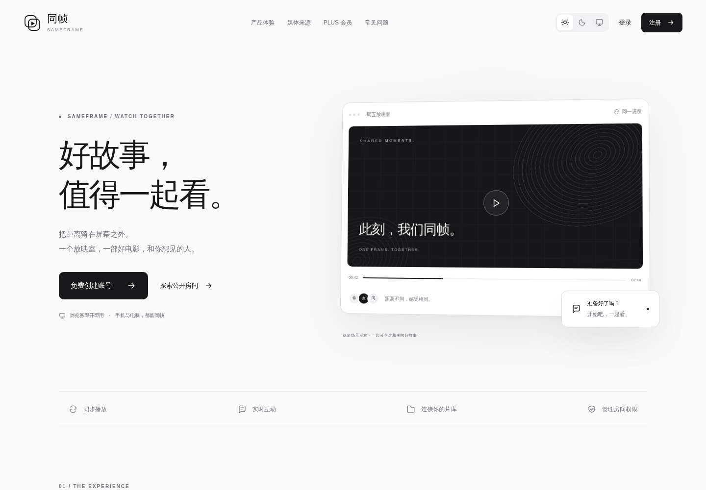
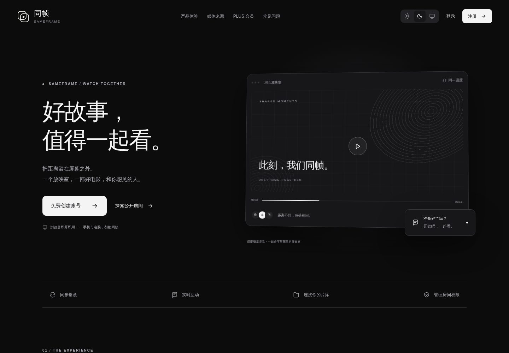
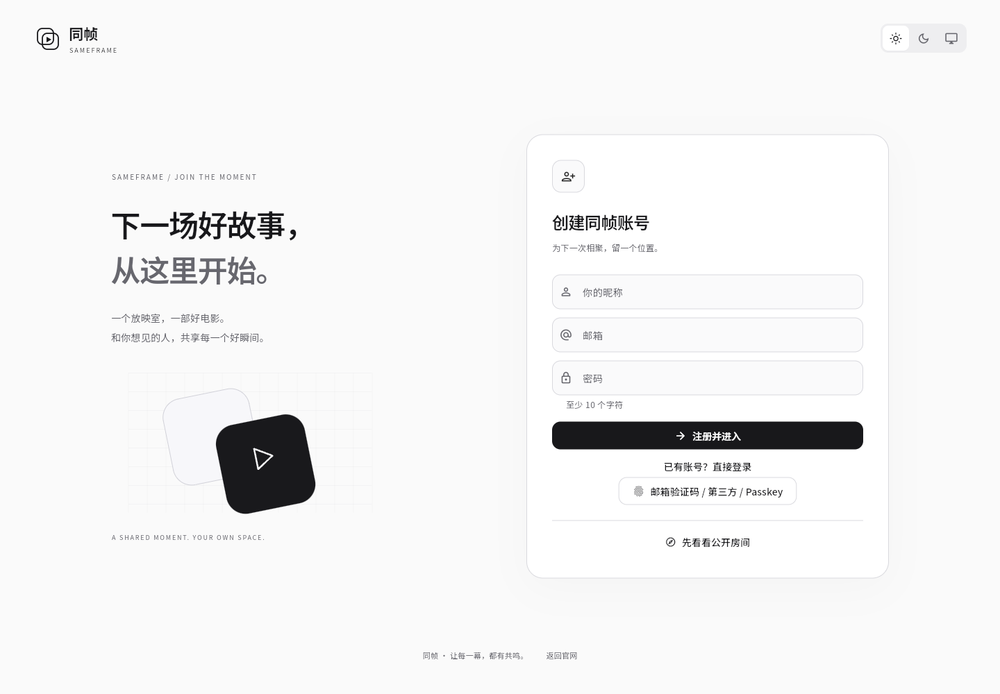
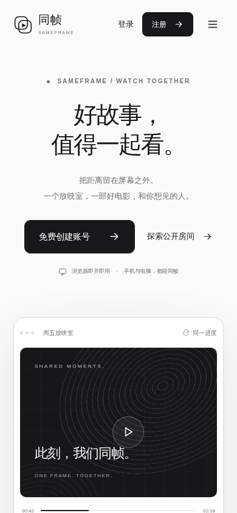
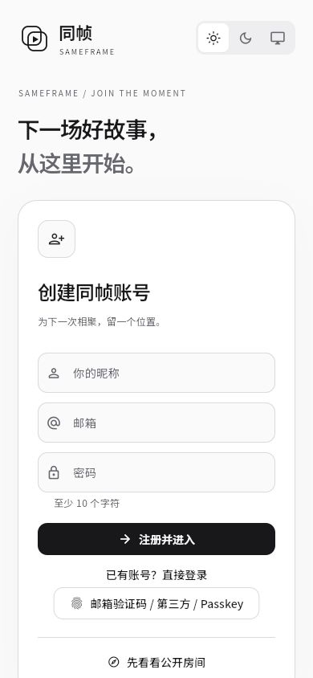

# 官方宣传网站与账号入口

状态：已于 2026-10-12 10:17 UTC 发布至 https://sameframe.top/。

本记录对应 `2a055fb` 版本。后续用户要求关闭访客访问、增加注册邮箱验证码并改为单按钮主题切换，将另行记录。

## 新增

- 官方首页：产品介绍、媒体来源、开始使用步骤、PLUS 积分会员与常见问题。
- 右上角登录、注册，以及可直接体验的公开房间入口。
- 普通用户登录/注册双栏页面，按参考图调整品牌介绍、插画、表单与移动布局。
- 官网与观影空间间共享深浅色/跟随系统偏好。
- `sameframe.top` 域名、HTTPS 证书及沿用自动续期任务；官网规范网址、站点地图。
- 随包提供 Noto Sans SC 中文字体（SIL OFL），避免应用依赖外部中文字体服务。

## 调整

- `/` 改为官方宣传首页；观影空间使用 `/app.html`。
- 登录入口 `/login.html`、注册入口 `/register.html`；认证成功后进入观影空间。
- 表单复用现有认证、双重验证、密码找回与安全会话存储，不把登录令牌放入 URL。
- PWA 启动地址及账号安全页的“返回观影大厅”链接指向 `/app.html`。
- 应用内增加返回官方网站的入口。
- 公开媒体链接使用新域名；允许域名和原 IP 的请求来源。
- 修复平板宽度下首页装饰光晕导致的横向滚动。

## 移除 / 保留

- 网站首页不再直接加载观影应用与播放器资源。
- 原有房间、媒体源、会员、管理后台和账号数据保留。
- 宣传内容按当前功能编写，不添加虚构用户量、评价、平台合作或下载入口。

## 基线与回滚

- 修改前仓库：`30c400f`（会员体系发布记录与截图）。
- 修改前应用：`10e6032`。
- 基线标签：`rollback/pre-official-website-20261012`。
- 备份目录：`/opt/sameframe/backups/official-website-20261012-101606`；包含原网页、服务端与 PostgreSQL dump。
- 发布清单：`/opt/sameframe/releases/official-website-2a055fb/deployment.json`。
- 网页与服务端回滚：`python3 /opt/sameframe/releases/official-website-2a055fb/release.py --rollback`。
- 域名配置回滚：`python3 /opt/sameframe/releases/domain-20261012-082536/configure-domain.py --rollback`。
- 两项 `--check-rollback` 均已通过。回滚不恢复旧数据库、不删除新增用户活动。
- 本次不增加数据库结构，不修改已有账号、积分或会员数据。
- 域名配置单独备份，支持独立回滚；网站回滚会清理该版本新增的静态文件。
- 浏览器账号会话按域名隔离，原 IP 已登录的用户在新域名需重新登录；账号本身保持一致。

## 验证

- [CI 38228524612](https://github.com/kawaiilord/devbox/actions/runs/38228524612)：服务端 race / PostgreSQL / Redis 测试、Flutter analyze / tests / Web 构建、Windows / Linux 构建、服务端镜像检查全部成功。
- 线上 HTTP：官网、登录、注册、观影入口、readyz 均 200，数据库与 Redis 就绪。
- 线上浏览器：首页不加载 Flutter；登录/注册切换与主题延续；820 / 390 / 320 宽度导航、FAQ、无横向溢出；访客公开房间入口通过。
- 隔离环境真实注册表单通过，返回官网再进入可恢复会话，错误密码返回 401 且显示错误。长流程自动化在后续登录页面检测时遇到本机 Chromium 协议超时；不能将整条流程标为全通过。
- 阻断外部字体服务后，注册页及观影页中文截图仍完整。随包字体约 17.8 MB，首次进入应用需要下载；官网首页使用系统字体。
- 主域名证书有效期至 2027-01-10；`sameframe-tls.timer` 运行中。HTTP 跳转 HTTPS，原 IP 证书入口保留。
- 线上部署文件已比对 SHA-256，回滚备份校验通过。

## 版本与资源

- 代码：`2a055fbcb681abca8dceda74acd72fba17e9407f`。
- 主应用 JS：`8958b11fea1b21414cc096eb61e4fb6998bdd121b53658b2b1266415b5753d30`。
- 首页：`d3dc3c793149934653cfaf388fc661676bdc32815c35ee594b1225cb17eb6eec`。
- 服务端：`6f74a5f1ee20f667683b4ac894cf864e34a53cb7cfa107015bc26f334efe8262`。

## 线上截图

