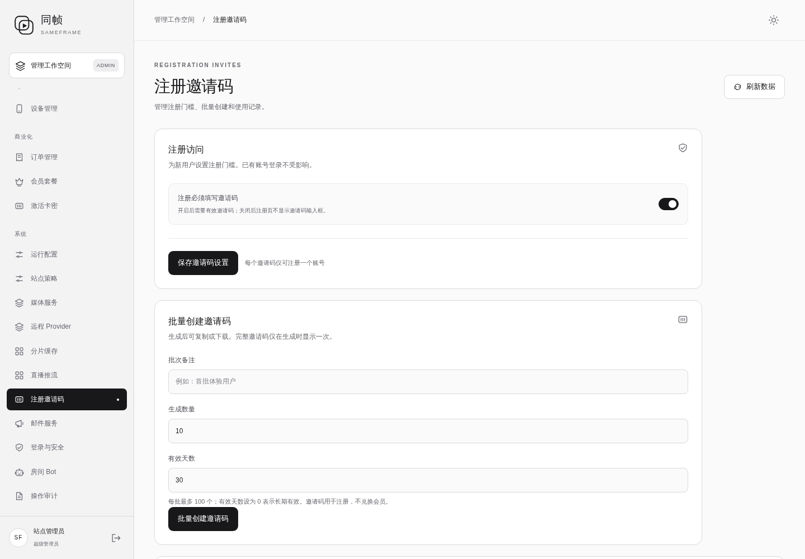
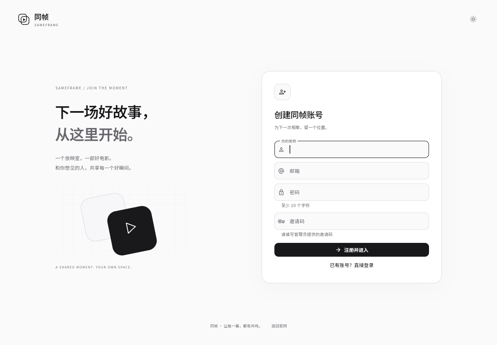
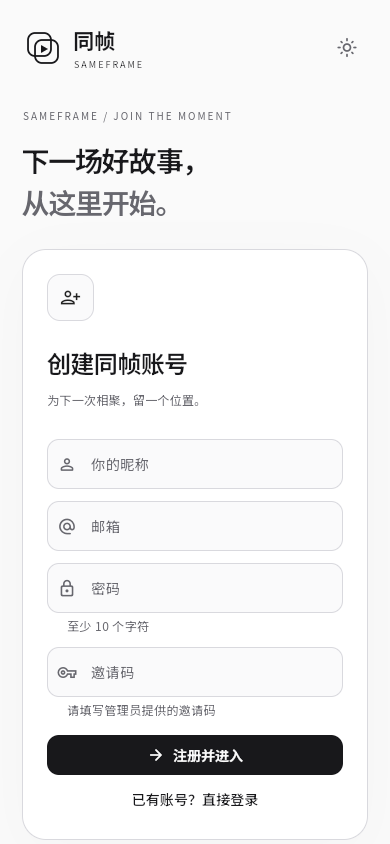

# 注册邀请码与暂停注册邮箱验证码

状态：已于 2026-10-12T16:34:33Z 发布至 https://sameframe.top/，当前开启邀请码要求，注册邮箱验证码已暂停。

## 新增

- 后台“注册邀请码”：开启/关闭注册邀请码要求，批量创建、状态筛选、使用记录、撤销。
- 每批 1–100 个，一码一账号；有效期 0–365 天，0 为长期有效，默认 30 天。
- 完整邀请码仅生成时返回，可复制和下载 TXT；服务端持久化只保存哈希及末尾提示。
- 邀请码消耗与账号创建处于同一数据库事务；账号创建失败不消耗，重复/并发使用仅一个成功。
- 新增 `021_registration_invites` 表及索引，记录创建、使用、撤销审计。

## 调整

- 暂停注册邮箱验证码，不要求发送或填写邮件验证码；注册不会自动发送验证邮件。
- 注册页从服务器读取注册规则，按开关显示邀请码；规则加载失败时禁止提交注册，可重试或登录已有账号。
- 邀请码规则在后端校验；失效、撤销、已用或缺失均拒绝。关闭后不要求或消耗邀请码。
- 若启用注册审批，通过邀请码只创建待审批账号；该邀请码仍被消耗。
- 邀请码不证明邮箱归属，新账号邮箱仍标记未验证。登录及房间仍要求真实注册账号。
- 第三方自动创建新账号也遵守邀请码限制；已关联身份的原账号登录不受影响。

## 移除/保留

- 注册页暂时移除邮箱验证码输入与发送按钮，保留后端验证码能力供未来配置发信后启用。
- 邀请码仅用于注册；原会员激活码、积分与会员数据保留。
- 自建邮件配置保持准备状态，当前没有启用外部发信。

## 版本、验证与回滚

- 代码基线 `fdfeba0`，应用基线 `4bbf313`，标签 `rollback/pre-registration-invites-20261012`。
- 数据库迁移为新增表；代码回滚保留新账号、邀请码记录与其他用户活动，不还原旧数据库。
- CI 已验证权限、开关、正确/错误/过期/撤销邀请码、重复邮箱失败、并发单次消费、审批、批量上限和明文不泄漏；内存及 PostgreSQL 均通过。
- [构建 38275351996](https://github.com/kawaiilord/devbox/actions/runs/38275351996) 五项任务全部成功，应用代码 `5f11fbc`。
- 隔离浏览器已通过后台开关、真实批量创建 3 个邀请码、TXT 下载、使用记录、缺失/错误邀请码拒绝，以及有效邀请码真实注册后进入观影空间。
- 邀请码关闭后字段隐藏，无邀请码真实注册返回 201 并进入观影空间；邮箱仍标记未验证。
- 注册页在桌面、390/320 像素手机布局下验证通过；最终浏览器检查无 JavaScript 异常。
- 自动化曾将 `-` 模拟为不一致的小键盘事件，已改为标准 Minus 键；本机资源紧张导致长流程超时后，将开放注册独立验收，通过后发布。
- 发布前临时关闭注册，更新完成后开启邀请码要求；回滚脚本一并恢复原注册策略。
- 线上 API 与浏览器验收通过：邀请码要求开启、注册开放、邮箱验证码要求关闭；无邀请码注册返回 400，验证码发送接口返回 403，匿名房间列表仍返回 401。
- 已有管理员正常登录；可读取后台邀请码管理及当前策略，PostgreSQL/Redis 健康。
- 正式环境未创建测试账号、未发送邮件、未生成测试邀请码；管理员可在后台创建第一批。
- 备份：`/opt/sameframe/backups/registration-invites-20261012-163336`（原网页、服务端、PostgreSQL dump）。备份校验已通过。
- 发布清单：`/opt/sameframe/releases/registration-invites-5f11fbc/deployment.json`。
- 原注册策略与新策略：`/opt/sameframe/releases/registration-invites-5f11fbc/invitation-policy.json`。
- 完整回滚：`python3 /opt/sameframe/releases/registration-invites-5f11fbc/invitation-release.py --rollback`，恢复应用及原注册策略。不要只执行应用回滚来替代完整回滚。
- 回滚后原版本将重新要求注册邮箱验证码；新增邀请码表与已创建账号保留。
- 主 JS SHA-256：`7a8cd4769ad36f7efab3c3fd497dbc2dd5117084eac372d18326b4cf0a3cd169`。
- 服务端 SHA-256：`aa4cefcdb9812e6171cebf15d64eb4293d6ca7afd2249b5d44d2447f81f578d4`。

## 使用位置

- 注册：[sameframe.top/register.html](https://sameframe.top/register.html)。
- 管理：[sameframe.top/admin/](https://sameframe.top/admin/) → 系统 → 注册邀请码。
- 调整开关后点击“保存邀请码设置”；批量创建时填写数量与有效天数，及时复制或下载完整邀请码。

## 线上截图

