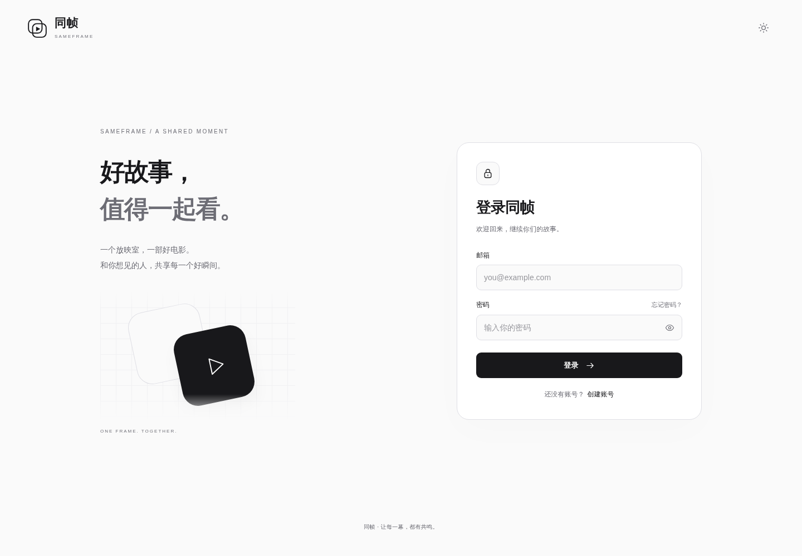
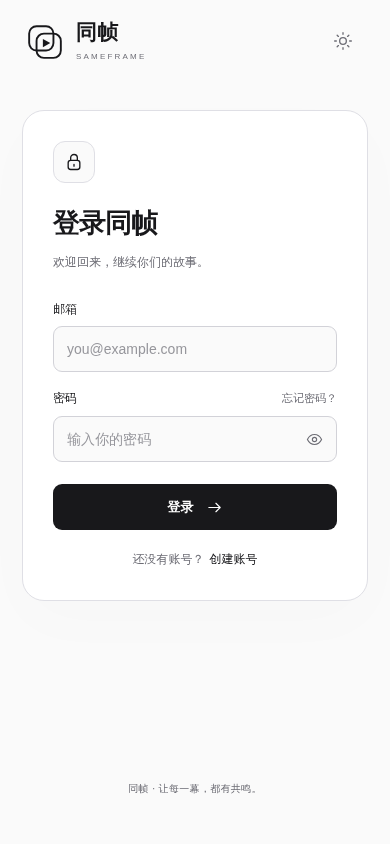
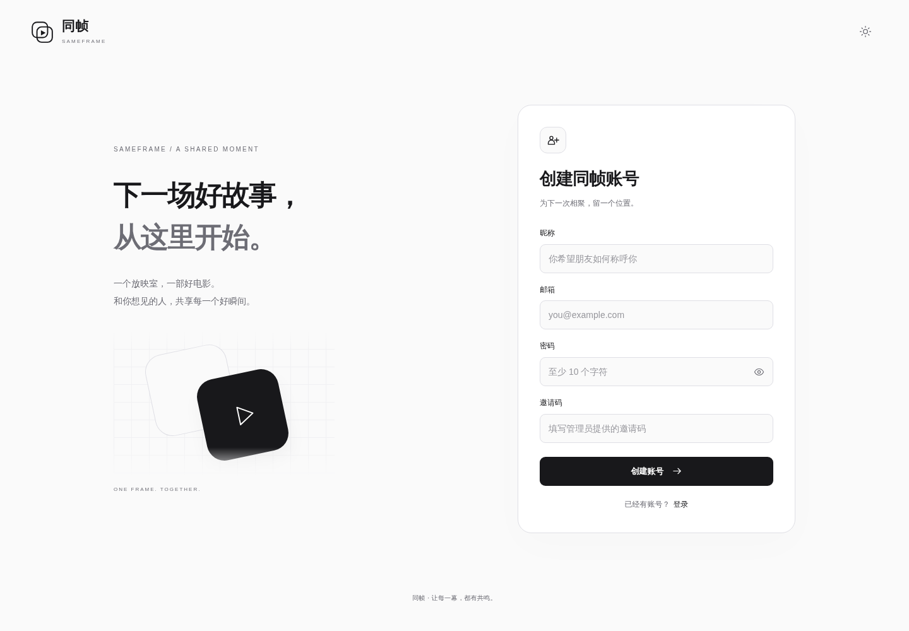
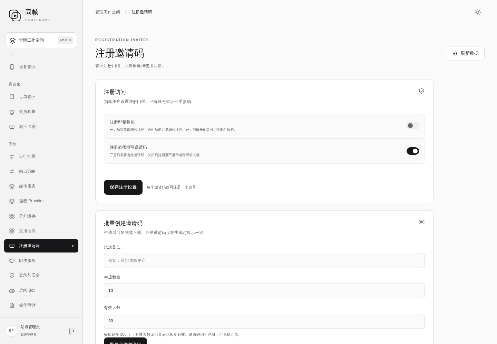
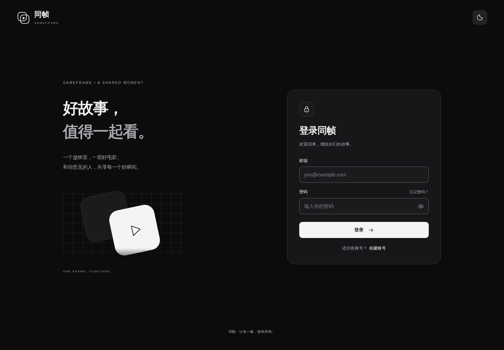

# 邮箱验证开关、简洁地址与轻量账号页

状态：已发布并通过正式站点验收。应用版本 `f969cd619c35f6250a83a9e8739a63b395a1032e`，上线时间 **2026-10-13 00:49 UTC**。

入口：[登录](https://sameframe.top/login)、[注册](https://sameframe.top/register)、[管理后台](https://sameframe.top/admin/)。

## 新增与调整

- 后台“注册邀请码”和“站点策略”增加独立的“注册邮箱验证”开关；关闭时前台不显示验证码输入或发送按钮，开启时后端强制验证。邀请码开关独立保留。
- 登录、注册、找回密码使用独立 HTML/CSS/JS 表单。账号页首次显示不加载 Flutter、播放器、WASM 或中文字体包。
- 继续采用黑白主题、透明标志、太阳/月亮单按钮；桌面双栏，手机聚焦表单。
- 支持密码显示、自动填充、动态注册规则、失败重试、邀请码、验证码及倒计时、注册审批和 MFA。
- `/login`、`/register`、`/forgot-password`、`/app` 作为正式路径；旧 `.html` 路径 308 跳转，官网链接与 PWA 启动入口同步更新。
- 登录后通过短时、单次、设备绑定的 HttpOnly / Secure / SameSite=Strict Cookie 进入应用；长期会话继续由原加密存储管理，不把令牌放在 URL 或账号页持久化存储中。
- nginx 为网页资源启用 gzip，并为账号页面设置 no-store 与内容安全策略。

后台操作：**系统 → 注册邀请码 → 注册访问 → 注册邮箱验证 → 保存注册设置**；“站点策略”中也能修改同一设置。开启时服务端要求有效验证码，关闭时服务端允许无验证码注册，前台隐藏验证码输入和发送按钮。注册页进入、重新聚焦以及提交规则错误后会刷新设置。

## 移除/保留

- 移除账号页的 Flutter 启动等待层、播放器依赖与大字体下载。
- 保留原账号、邀请记录、权限、会员、原有安全会话与未登录房间访问限制。
- 当前邮箱验证保持关闭；切换开启前需配置可用发信服务，开关不等于邮件送达配置完成。

## 已完成验证

- [最终 CI 38328297826](https://github.com/kawaiilord/devbox/actions/runs/38328297826) 五项任务全部通过：服务端、运行时镜像、Flutter Web、Windows、Linux。包含 Go 全量竞争检测测试、PostgreSQL/Redis 集成、Flutter 静态分析、测试及平台构建。
- 后端新增测试覆盖邮箱验证开启/关闭、显式关闭覆盖旧环境开关、邀请码独立校验，以及交接 Cookie 的匿名拒绝、设备绑定、单次消费、过期、设备撤销和跨来源拒绝。
- 隔离浏览器实测后台切换、前台字段显示/隐藏、测试邮箱验证码注册、邮箱已验证状态、应用会话交接、刷新恢复、错误密码提示及已有账号登录。测试邮件只写入隔离夹具，未向真实邮箱发信。
- 上述完整注册浏览器验收使用 `704ff57` 构建；最终版本仅追加后端来源检查，客户端产物校验一致，只有 Flutter 引导文件内的服务工作线程版本号变化。最终后端来源检查通过 CI 和生产 403 拒绝检查。
- **正式域名浏览器验收**：管理员界面开关、验证码关闭时隐藏、当前邀请码规则、黑白主题、密码显示、390/320 像素手机适配、无未捕获脚本异常；账号页没有 Flutter、WASM、播放器或中文字体请求。
- **正式域名现有账号验收**：原生密码表单登录 → 单次 Cookie 交接 → 同一账号进入 `/app` → 全页刷新恢复 → 点击退出回到 `/login` → 未登录打开 `/app` 回到登录页。未创建生产测试账号，未修改线上注册规则。
- `/login`、`/register`、`/forgot-password`、`/app` 返回 200；对应 `.html` 和末尾斜线地址均 308 跳转并保留查询参数；gzip、账号页面缓存策略与内容安全策略生效。
- 正式站点静态资源与最终构建 SHA-256 一致；匿名读取公开房间返回 401；PostgreSQL、Redis 与 `/readyz` 正常；备份文件哈希及旧容器镜像校验通过。

验收记录：[隔离浏览器](validation/2026-10-13-fast-auth-validation.json)、[生产界面](validation/2026-10-13-fast-auth-live-validation.json)、[生产会话](validation/2026-10-13-fast-auth-live-session-validation.json)、[HTTP/资源](validation/2026-10-13-fast-auth-live-http-validation.json)。

## 首屏效果与边界

- 登录页 HTML 加基础资源共 **24,044 字节（解压后约 24 KB）**；旧账号页需要的中文字体本身为 17,772,300 字节，新账号页不再请求它。
- 本次 Chromium 从测试机器访问正式域名，首次内容绘制 **440 ms**；这是一次实测，不代表各地区和设备的固定速度。[原始性能记录](validation/2026-10-13-fast-auth-live-performance.json)
- 登录后的观影工作空间仍会加载应用与播放器资源。本次消除的是进入登录/注册表单前的应用启动等待。
- 生产继续保持：开放注册、邀请码必填、注册需审批、访客关闭、邮箱验证码关闭。邮箱输入仍用作账号标识。
- 自建邮件服务仍未启用；开启邮箱验证前须完成发信配置。找回密码的实际邮件送达同样依赖邮件服务。
- 注册审批与 MFA 使用既有后端流程；本次没有在生产账号上开启 MFA，也没有新增生产审批申请。











## 基线与回滚

- 仓库基线 `53bf2d8`；应用基线 `5f11fbc`。
- 标签：`rollback/pre-fast-auth-20261013`。
- 无数据库结构变更，复用站点策略及短期挑战存储。
- 应用备份：`/opt/sameframe/backups/fast-auth-20261013-004755/`，含旧网页、后端二进制、PostgreSQL 自定义格式备份；数据库备份目录可读取性已经 `pg_restore --list` 验证。
- nginx 备份：`/opt/sameframe/backups/fast-auth-routing-20261013-004752/nginx.conf`。
- 旧镜像：`sameframe-app:before-fast-auth-f969cd6`；当前镜像：`sameframe-app:fast-auth-f969cd6`。
- 发布记录：`/opt/sameframe/releases/fast-auth-f969cd6/deployment.json` 及同目录 `routing.json`；已记录新增文件，回滚时只删除本版新增文件。
- 回滚校验已执行成功；未为验证而中断线上服务执行实际回滚。

在服务器执行完整回滚（同时恢复应用、网页及 nginx 路由）：

```sh
python3 /opt/sameframe/releases/fast-auth-f969cd6/fast-auth-release.py --rollback
```

回滚保留上线后的账号、积分、邀请码及其他数据库活动，不导入旧数据库。旧版继续沿用当时的注册策略行为，不识别新增邮箱验证开关。

### 实际产物 SHA-256

| 产物 | SHA-256 |
| --- | --- |
| 新后端 | `7cf0a6620dfb59c78cdbaf353e7325d31c6c9430dbab4be4abdc4ee9519aedf1` |
| 新 `main.dart.js` | `918678f68701d801998a456fcb0994b686ffda518377a0549457d9bc5546317a` |
| 新 `login.html` | `31d0900a7e5e261a5494f4aa5d1eb436cc07f362589d117401cf00fb128bb346` |
| 新 `register.html` | `e9057af23395da692df5c317d602e98672f035b9606337bc0d0834cafd89782e` |
| 新 nginx 配置 | `b66e7712942ee0ac0af986dac1c8a787684a79ba24e769e2a2607021fa9399c3` |
| 发布网页归档 | `43213e1350816bb814694482f56a0c857078593f863fb71df8022243f8e97751` |
| 旧后端 | `aa4cefcdb9812e6171cebf15d64eb4293d6ca7afd2249b5d44d2447f81f578d4` |
| 旧 `main.dart.js` | `7a8cd4769ad36f7efab3c3fd497dbc2dd5117084eac372d18326b4cf0a3cd169` |
| 旧网页备份 | `1f7bd43a49f22d01ec92a82c80c02dc1c48d50badf4b0da66c88d3eef00796f9` |
| 数据库备份 | `055d263db2c6e26f626d5eb805a0eb2f6906f32b4c8daffd4c6986bc7ca84e01` |
| 旧 nginx 配置 | `cab616498b3cb0379024f809046876046354f7affe69e70a309c1f77df280f81` |

## 设计与技术参考

- [GitHub 登录页](https://github.com/login)：清晰的标签、密码找回和直接显示的表单。
- [MDN Cookie 说明](https://developer.mozilla.org/en-US/docs/Web/HTTP/Reference/Headers/Set-Cookie)：HttpOnly、Secure、SameSite、Path 与短期有效性。
