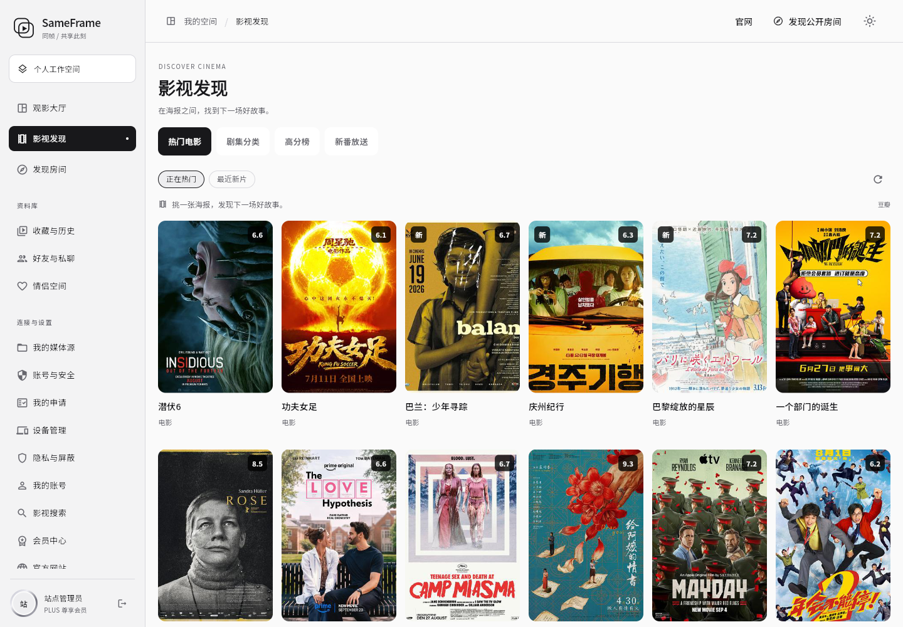

# 影视发现：热门电影、剧集分类、高分榜与新番放送

状态：**已于 2026-10-13 05:29 UTC 发布并通过正式站点验收**。版本 `76dffcc92fd6d7c0bd03a75d745c12f828ded1a0`，基线 `b1271cd`，回滚标签 `rollback/pre-film-discovery-20261013`。

入口：[登录同帧](https://sameframe.top/login)后，电脑左侧 **观影大厅 → 下方“影视发现”**；手机底部 **全部 → 影视发现**。

## 新增与调整

- 用户工作区在“观影大厅”下方新增“影视发现”；在同一工作区切换内容，手机继续使用原底部导航，可从“全部”菜单进入。
- 四个页签：热门电影（热门/最近新片）、剧集分类（国产、美、英、日、韩、港、动画、综艺、纪录片）、高分榜（电影/剧集）、新番放送（今日及星期筛选）。
- 海报网格自适应手机/电脑，展示片名、评分、更新提示；点击打开资料弹层，可复制片名或访问资料来源。
- 服务端读取豆瓣公开片单与 Bangumi 放送表，不需要新增 API Key；高分榜从当前片单筛选 8 分及以上作品并排序，不宣称是全站 Top 250。
- 新增 `GET /api/v1/discovery`，必须为已注册登录账号；分类与页码有白名单和上限。
- 元数据共享缓存 30 分钟，同类并发请求合并；上游故障时可返回 24 小时内缓存并明确标记，失败重试有冷却。
- 海报由受限代理加载，使用独立的短期签名，不在图片 URL 中携带登录令牌。只允许指定图片域名和路径，验证 DNS、重定向、内容类型与大小，并限制并发及缓存容量。
- 沿用现有黑白主题、导航和账号权限；本次不删除已有界面或功能。官网入口、语音及会员功能不属于本次功能改动。
- 增加独立网络连通性检查工作流，确认开发机访问路径异常时服务器仍在线。本次通过既有 GitHub 云电脑建立 SSH 通道发布，未改服务器端口、防火墙或登录凭据。

## 数据及展示边界

- 本模块提供影片发现与资料浏览，不把第三方资料页当作可播放地址。选片播放继续使用现有媒体源。
- 海报与评分标注来源。上游数据可能变化、限流或暂时不可用，界面提供空态与重试，不填充虚构影片；单张海报缺失时显示占位图，不影响分类浏览。
- 新番“今日”按北京时间选择星期；放送信息以资料源为准。

## 已完成验证

- [最终 CI 38350365146](https://github.com/kawaiilord/devbox/actions/runs/38350365146) 五项任务通过：服务端、服务端运行镜像、Flutter Web、Windows、Linux。包含 Go 竞争检测、PostgreSQL/Redis 集成、Flutter 静态分析和测试。
- 新增后端测试：未登录和非法参数不访问上游；剧集高分排序、过滤、去重；北京时间星期选择；分页边界；并发合并、失败冷却和过期缓存；海报签名伪造/过期、私网目标拒绝、图片格式校验与缓存。
- 新增客户端测试：320/390/1440 宽度和深色模式；分类/星期切换；迟到请求不覆盖新分类；错误重试；分页追加；功能入口位于大厅下方且使用原工作区和手机底部导航。
- 隔离真实数据浏览器验收与正式域名浏览器验收均通过：电影海报、资料弹层、美剧筛选、高分电影、新番今日/周一切换、手机浅深色主题。正式站点成功获取 62 个海报响应，无未捕获脚本异常。
- 正式接口验证：`/api/v1/discovery` 与公开房间列表未登录均返回 401；伪造海报签名返回 403；生产电影、剧集与 Bangumi 上游连通。
- 生产二进制与网页哈希匹配最终构建；nginx、Compose 与 TURN 配置哈希保持一致；语音功能启用、邀请码开启/邮箱验证码关闭的规则保留，PostgreSQL/Redis 就绪。
- 旧镜像与备份校验通过。未为测试实际回滚生产服务。

证据：[隔离浏览器](validation/2026-10-13-film-discovery-validation.json)、[生产浏览器](validation/2026-10-13-film-discovery-live-validation.json)、[生产 HTTP/配置](validation/2026-10-13-film-discovery-live-http-validation.json)。

## 正式站点截图




## 发布与回滚

无数据库结构变更。发布前备份网页、后端与数据库；回滚只恢复应用版本，不恢复旧数据库，保留新增用户活动。

- 备份目录：`/opt/sameframe/backups/film-discovery-20261013-052835/`。
- 发布清单：`/opt/sameframe/releases/film-discovery-76dffcc/deployment.json`。
- 旧镜像：`sameframe-app:before-film-discovery-76dffcc`；新镜像：`sameframe-app:film-discovery-76dffcc`。
- 回滚命令：

```sh
python3 /opt/sameframe/releases/film-discovery-76dffcc/release.py --rollback
```

| 产物 | SHA-256 |
| --- | --- |
| 新后端 | `a3726c4fd7302fc221f8519db4775b18e9cf09986252d9bdb46f952726d97f26` |
| 新 `main.dart.js` | `9df1b39aacb99da72a0b2f1032e8028f3cea6431ec343fc67d349ed02958f249` |
| 网页发布归档 | `675f6a9c13b25921fd17a8b827a933e0812b5a3354e82068a4d258ae7989c7bc` |
| 旧后端 | `3df9350bc1fb41fa0b1cad6b5a3af9fdd022f0b5c8e1498df20ec4592ead10be` |
| 旧 `main.dart.js` | `9b52cb9fad0a9bba7b7ed142b6bba676f5260682b296c882b1b6b59b8312e695` |
| 旧网页备份 | `b1812d7a5f1edb531cd6dfc4ee19e54a5a432e2f8e039398b1fb2aeac04ee559` |
| 数据库备份 | `2a030726c34e417aadfb53210f0c246ad35b4eb41fc87878579be3da748e54a7` |

本次一并补齐上一轮已部署的语音修复、官网入口变更的验收记录；没有重新修改这两项业务功能。

## 参考

- [Bangumi API](https://bangumi.github.io/api/)
- [豆瓣电影](https://movie.douban.com/)
- [LibreTV 推荐功能说明](https://libretv.is-an.org/wiki/Recommendations.html)：仅参考功能组织，本次服务端与 Flutter 界面使用项目原有架构实现。
