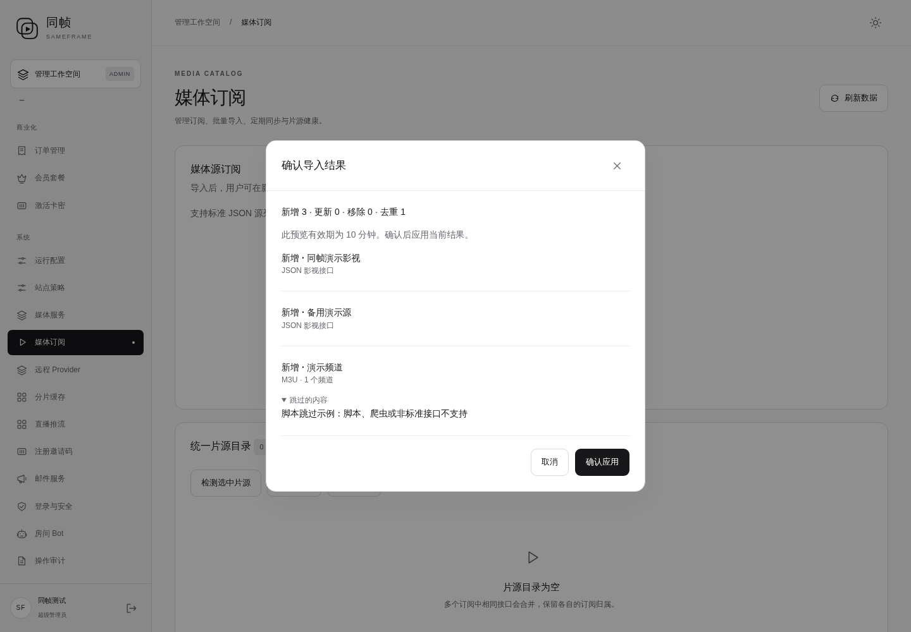
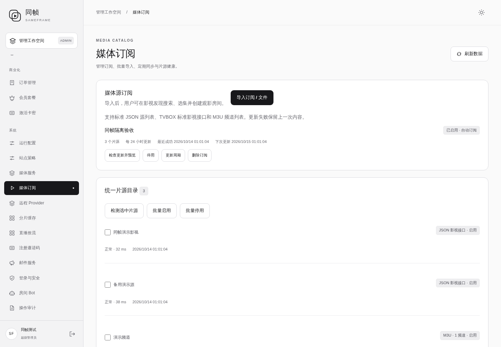
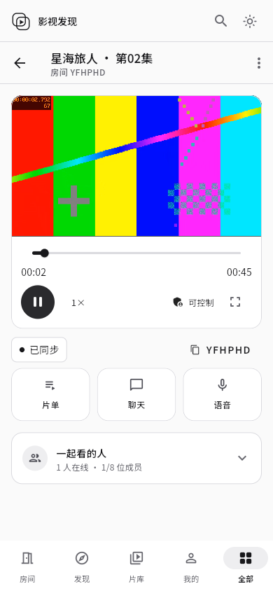
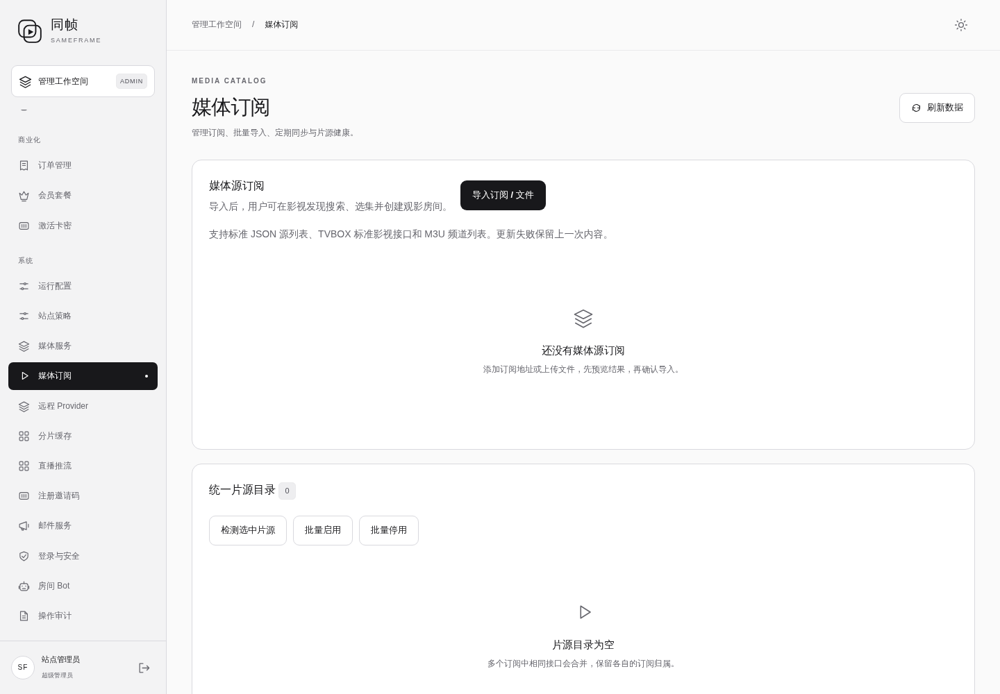
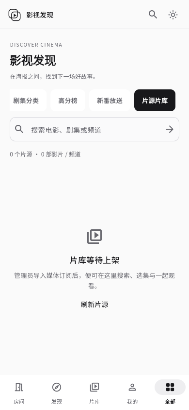

# 媒体订阅、聚合搜索与发现播放

状态：已于 **2026-10-14 01:08:58 UTC** 发布，已通过正式站点验收；启动脚本生成问题已修复，最终 CI 产物已于 01:21:17 UTC 安装归档。开发起始日 2026-10-13。

业务基线 `0fee915`，发布前线上应用 `76dffcc`；回滚标签 `rollback/pre-media-subscriptions-20261013`。用户授权开发、构建和部署，并明确真实订阅稍后导入。本轮仅使用隔离演示源，不往正式片库添加测试数据。

## 新增

- 后台“媒体订阅”：URL 订阅、文件 / 文本批量导入、确认前结果预览、接口去重、启停、删除、定期更新与结果记录。
- 标准 JSON 源列表、`api_site`、TVBOX 标准 JSON 影视接口以及 M3U 频道部分；不兼容的爬虫 / 脚本等会在预览中注明。
- 每 1–168 小时更新，默认 24 小时；失败、空列表、无效格式保留上次结果。数据库 CAS、任务租约和版本检查避免重复提交和覆盖并发修改。
- 批量检测、最近耗时、连续失败三次的 5 分钟冷却、主动检测与恢复。
- 影视发现新增“片源片库”；海报点击后查找已导入片源、同片来源与线路、选集、整剧建房或原子加入已有房间的片单。
- 逐源增量搜索；标题、年份和类型相同的影片合并。未知年份、不同季和不同版本保守分开；备用片源按集名 / 集数对应，不按数组序号盲目匹配。
- 服务端加密订阅配置、受限 HTTP 获取、受房间权限约束的短期播放票据，以及签名海报代理。
- 两次播放重试后由房主发起同集统一换源，保留播放位置与暂停 / 播放状态。旧版本票据和重复换源请求失效。

## 修改

- “影视搜索”默认进入可播放的聚合片源搜索；“资料与影评”保留原资料搜索和影评流程。
- 修复媒体代理在“必须登录”策略开启时使用不完整用户资料校验、误拒绝合法票据的问题。现在从数据库读取完整账号，并继续验证会话版本、账号状态、房间成员和片源版本。
- 初次媒体加载失败后仍建立房间连接、开放控制与恢复操作，避免无法进入片单或换源。
- 手机当前栏目可见；保留底栏、黑白浅深主题、透明品牌图与工作区内切换。
- 浏览器验收实际遇到外部 CDN 下载渲染文件中断。新增 Flutter 引导配置，从本站加载构建中已包含的匹配版本渲染文件。

## 删除

没有删除既有功能或用户数据。影视发现的原“仅资料”行为升级为资料与片源选择；资料入口保留。网页启动移除对外部渲染 CDN 的默认依赖，使用本站对应资源。

## 验证

- Go 单元、竞争检测及 PostgreSQL / Redis 集成覆盖：导入不写入、去重和引用保留、配置加密 / 不泄露地址、过期预览、更新失败保留旧值、版本冲突、持久化与重启迁移、冷却和恢复。
- 开启真实登录限制的双节点媒体集成：HLS 清单 / 分片、注册用户鉴权、片单原子追加、并发恢复只生效一次、旧播放票据撤销。
- Flutter 测试覆盖 320 / 390 / 1440 宽度、逐源返回、失败源隔离、同片归并、选集建房参数、审核反馈、空片库、资料和影评工作区导航；播放器适配器测试通过。
- 隔离浏览器七项验收通过，无未捕获脚本错误：后台导入预览 / 去重 / 批量检测，聚合搜索与资料切换，海报，浅深手机界面，第 2 集建房并实际播放 HLS，故障注入两次重试后自动统一换源，未登录拒绝。
- 保留检测得到的启动 CDN 故障和媒体鉴权问题的修复，未对正式环境放宽登录策略。

隔离验收：[数据](validation/2026-10-14-media-catalog-browser.json)。[使用说明与格式](../media-catalog.md)。








## 边界

未配置真实片源，生产片库初始为空。未宣称兼容所有 TVBOX 配置：不执行 JAR / JS / Python / 爬虫，不提供 DRM 解锁、XML 或私有解析器。供应方需要特殊请求头或网页解析时需要专用适配，不能把网页当视频。当前主路径验证为 HLS 及普通 HTTP(S) 视频文件。

24 份订阅、64 个独立片源、单次输入 2 MB、加密目录 8 MB；每次最多读取 8 个 M3U，每个最多 2000 个频道；每房间 500 集、每集 8 个来源；更新记录最近 40 次。预览有效期 10 分钟，重启后失效；多节点预览与确认需保持同一节点。详情里最多整合 8 个同片来源。

## 数据与回滚兼容

022 仅新增 `catalog` 媒体类型，使用现有媒体源、片单和加密版本配置存储。019 原迁移在每次启动时重建类型约束，不能直接回滚到未修复的旧二进制。因此先独立构建兼容基线 `9c18aa335d775f815f06ebd2df3d7eae4f05849a`（CI 38354672984 全部通过），用于本轮回滚镜像，原始旧二进制也另外保存。

兼容基线保持旧业务功能并保留新类型约束。回滚不恢复旧数据库、不删除新账号、积分、订阅或片单；新增订阅片源在旧版暂不可播放，重新升级后可继续使用。

部署程序：[deploy-media-catalog.py](../../ops/releases/deploy-media-catalog.py)。部署前会校验构建后的启动脚本语法。

## 发布记录

- 业务应用版本：`f07becde86b583ea184005222aa4ef350877fc03`，CI [38493376300](https://github.com/kawaiilord/devbox/actions/runs/38493376300) 五项任务全部通过。
- 最终启动文件修复：`e6f1fd0f33d51381bb516e115a6c04216f5bdc71`，CI [38494613481](https://github.com/kawaiilord/devbox/actions/runs/38494613481) 五项任务全部通过，包含构建后 JavaScript 语法检查。与上一轮网页产物逐文件比较，只有启动文件变化。
- 发布时的正式浏览器检查发现启动变量被额外单引号包裹，生成脚本语法错误。立即替换为隔离验收已验证的同源启动文件恢复页面，并提交 `e6f1fd0` 修复模板；新增构建后 `node --check` 检查，防止同类问题。数据库和后台服务不受影响。
- 正式域名浏览器检查通过：登录后片源片库 / 空态、媒体订阅后台、资料与影评切换、手机浅深主题和底栏；渲染文件全部由 sameframe.top 返回 200，无脚本异常。
- 线上 HTTP 检查：6 个未登录入口均为 401；订阅和片源均为 0；邀请码开启、邮箱验证码关闭、注册审批开启；PostgreSQL / Redis 就绪。
- 官网首页、营销样式、nginx、Compose 和 TURN 配置哈希未变。
- 备份：`/opt/sameframe/backups/media-catalog-20261014-010827/`，包含数据库、原网页、原始服务器和兼容回滚服务器。
- 最终网页归档：`/opt/sameframe/releases/media-catalog-final-e6f1fd0.tgz`，重新部署请使用此归档；最初归档保留仅用于审计。
- 清单：`/opt/sameframe/releases/media-catalog-f07becd/deployment.json`。
- 回滚镜像：`sameframe-app:before-media-catalog-f07becd`，备份及镜像校验通过；没有为验收实际回滚生产。
- 回滚命令：

```sh
python3 /opt/sameframe/releases/media-catalog-f07becd/release.py --rollback
```

| 产物 | SHA-256 |
| --- | --- |
| 部署服务器 | `5dfc8498910f5995461f68926f88b5bdf560655a32cf9f7e78e765dd95c0de49` |
| 部署 main.dart.js | `0f4db14f4c28dac456f79d1ebaa30db81242c44fd24f88b46c6458c8feb3df3e` |
| 最终网页归档（含启动修复） | `f8c82a1a6268af158294c45beef175cc1e2799d23f8da5a34eeafd91522e6769` |
| 最终启动文件 | `bef75378bf3a2de5657bf5c6dc4c64a17278da32fc1240123b69ad7f0bfd02d3` |
| 兼容回滚服务器 | `beb6ca64a1a542796d3e67efa8fe4cc7a86aa3b753dccfbb966ade6ca682ce48` |
| 原始旧服务器 | `a3726c4fd7302fc221f8519db4775b18e9cf09986252d9bdb46f952726d97f26` |
| 旧网页备份 | `79391e2445519351a44a122ed0978a7cbeae4464313823bae9f8c76d2d93218c` |
| 数据库备份 | `27f95c058558f640fe78f13965f7b204d642e8ac6a7fad2132a5c4f88199bca6` |

正式证据：[浏览器验收](validation/2026-10-14-media-catalog-live-browser.json)、[HTTP 与配置校验](validation/2026-10-14-media-catalog-live-http.json)、[部署和回滚清单](validation/2026-10-14-media-catalog-deployment.json)。





## 参考

[Flutter 官方引导配置](https://docs.flutter.dev/platform-integration/web/initialization)说明本站渲染资源的 `canvasKitBaseUrl` 配置。AppleCMS JSON 字段与 M3U 标准按本项目架构重新实现，没有引入 LibreTV 的应用代码。
