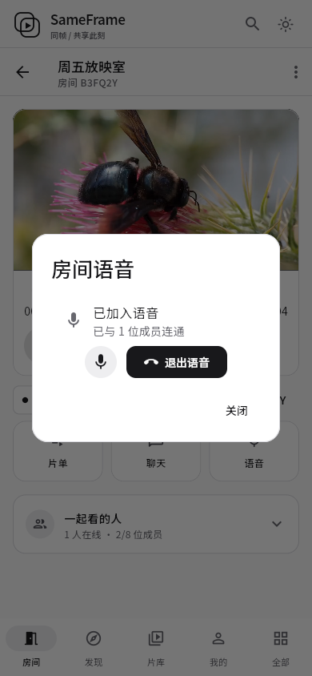

# 房间语音修复

状态：已于 2026-10-13 02:50 UTC 上线，版本 `b1271cd5e8a1d562e238548c5c34e6bb6b715a63`。上一轮被切换任务中断后，在本次发布准备中补齐实际验收记录。

## 已确认问题

- 生产没有配置 `SAMEFRAME_TURN_URLS` / `SAMEFRAME_TURN_SECRET`，也没有中继服务；`/api/v1/config` 的 `voice` 为 false，房间语音接口不可用。
- 客户端只创建连接，没有处理远端音轨并连接声音播放器。
- 异步信令可能重复创建连接；早到的 ICE 候选直接添加到尚未设置远端描述的连接；界面只根据麦克风是否打开显示“已连接”。

## 新增、修改、移除

- 增加远端音频输出、浏览器播放授权恢复按钮，以及连接/麦克风错误提示。
- 将握手改为双向 ready 后由固定一端发起；串行处理连接信令，缓冲早到的 ICE 候选，支持先后或同时加入。
- 按实际已连通成员数显示状态，替换技术性的 PeerConnection 数量；加入时防重复点击并显示进度。
- 静音控制本地音轨；退出、离开房间、权限撤销、房间关闭或连接断开时释放麦克风和连接。
- 修复离开房间时结束通知写入已关闭 WebSocket 的异常，确保后续声音连接清理能够完成。
- 配置自建 coturn，使用限时身份凭据；加入前仍须鉴权及房间语音权限，传入信令不会自行开启麦克风。

## 验证与发布

- [最终 CI 38337600138](https://github.com/kawaiilord/devbox/actions/runs/38337600138) 服务端竞争检测与 PostgreSQL/Redis 测试、Flutter 测试/静态分析、Web/Windows/Linux 构建和服务端运行镜像全部通过。
- 隔离账号的双浏览器房间实测：真实中继候选、双向收到音频、解码音频能量非零、音频元素实际播放；权限拒绝、静音、重入、离开房间释放麦克风均通过，无未捕获脚本异常。手机指 Chromium 390 像素布局；未覆盖 iOS/Android 真机及长时通话压测。
- 外部浏览器分别验证公网 TCP 和 TLS 中继双向音频；本机公网 UDP 探测未返回，服务器上的隔离浏览器使用 UDP 中继通过，客户端同时提供 TCP/TLS 选择。
- 正式域名用现有管理员账号创建临时私密验收房间，等待“已同步”后验证加入语音、退出及关闭房间均释放麦克风；临时房间已关闭，没有创建生产测试账号。
- 未登录访问房间语音配置与公开房间列表均为 401；注册规则保留邀请码开启、邮箱验证码关闭；PostgreSQL/Redis 就绪。
- [双人验收](validation/2026-10-13-room-voice-browser-validation.json)、[正式站点验收](validation/2026-10-13-room-voice-live-validation.json)、[HTTP 验收](validation/2026-10-13-room-voice-live-http-validation.json)。



## 基线与回滚

- 仓库基线 `5454ee8`，线上应用 `f969cd6`。
- 标签 `rollback/pre-room-voice-20261013`。
- 无数据库结构变化；发布前备份网页/应用/数据库与中继配置；回滚保留新增用户数据。
- 网页、后端及数据库备份：`/opt/sameframe/backups/room-voice-20261013-025014/`。
- 中继及证书续期配置回滚记录：`/opt/sameframe/backups/room-voice-infra-20261013-011751/`。
- 部署清单：`/opt/sameframe/releases/room-voice-b1271cd/deployment.json` 与 `turn.json`。旧应用镜像和备份校验通过；未为测试执行实际回滚。
- 后端 SHA-256：`3df9350bc1fb41fa0b1cad6b5a3af9fdd022f0b5c8e1498df20ec4592ead10be`。
- `main.dart.js` SHA-256：`9b52cb9fad0a9bba7b7ed142b6bba676f5260682b296c882b1b6b59b8312e695`。
- 数据库备份 SHA-256：`dde18561bbeabd6cc2cfc98466c5bed6f84ed236196dc88387b44e9127b1598a`。

完整回滚同时恢复上一版网页/后端、移除本次 TURN 服务配置并恢复证书续期脚本，保留数据库新活动：

```sh
python3 /opt/sameframe/releases/room-voice-b1271cd/voice-release.py --rollback
```

## 参考

- [Flutter WebRTC 音视频渲染接口](https://flutter-webrtc.org/docs/flutter-webrtc/api-docs/rtc-video-renderer/)
- [coturn 官方部署说明](https://github.com/coturn/coturn/tree/master/docker/coturn)
