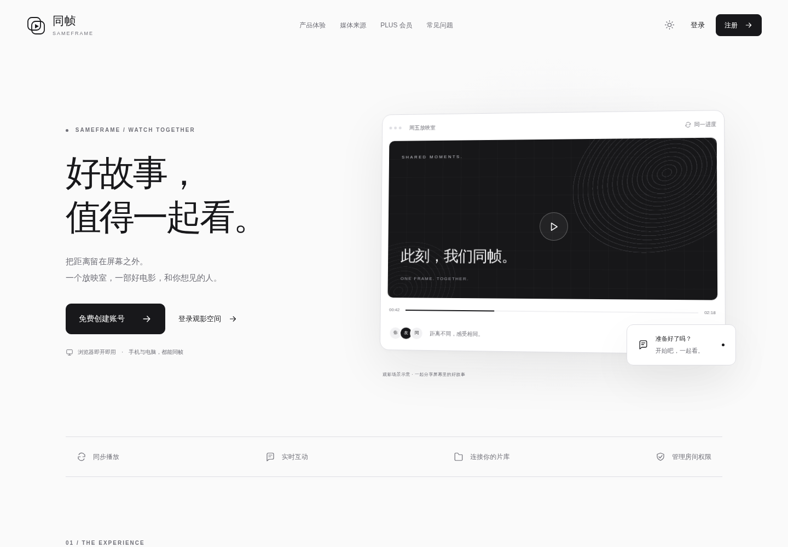

# 官网播放入口直达登录

状态：已随 `b1271cd` 于 2026-10-13 02:50 UTC 发布，正式站点验收通过。

## 修改

- 官网首屏演示图（包括中央播放按钮）直接链接 `/login`，不再先进入 `/app?discover=1` 加载完整应用。
- 首屏“登录观影空间”同样直接进入轻量登录页。
- 按用户确认保留原有时间轴、时间、头像、浮动聊天提示、窗口圆点及重复入口；官网原布局和样式保留。
- 本项没有删除界面元素或实际功能。

## 验证与回滚

- 正式域名电脑/手机点击播放图及“登录观影空间”均直达 `/login`，网络请求没有提前下载 Flutter、WASM 或完整应用，无未捕获脚本异常。
- 原时间轴、时间、头像、浮动聊天提示及重复页脚入口全部保留；样式文件与修改前字节一致。
- [浏览器验收](validation/2026-10-13-room-voice-homepage-validation.json)。
- `index.html` SHA-256：`7dd1f14ec291649e6e4e0001ae48d50a390623c991afd08d90c6c38114fb3576`；`website.css`：`239a223ab3f3dd3d71e82df7eb97b6169f563c0553253d95f86d5bbeb2608b99`。
- 静态文件包含于本次 `room-voice` 网页归档；完整版本备份和回滚见[语音修复记录](2026-10-13-room-voice.md)。

