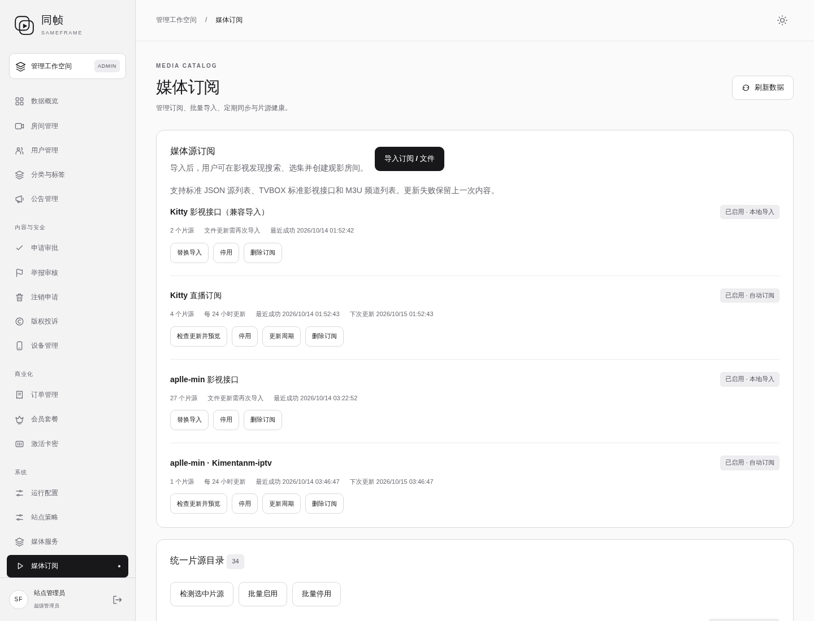

# aplle-min.json 导入与 APTV 直播兼容

用户要求导入附件 `aplle-min.json`。输入 SHA-256：`75f970e77b91d9cac36c22840374f4df391b4117e330fd9927377fac240050bf`。

## 已完成

- 27 个 `type=1` 影视接口已从后台预览并确认导入，正式服务器的 27 项接口检测全部通过。这只表示接口能读取，不等于已逐部验证视频播放。
- migu 列表只有 M3U 头信息，没有频道，跳过且未影响影视接口导入。
- Kimentanm 列表包含 APTV 扩展声明和每频道 `http-user-agent`。修复原导入器误判后，按原地址订阅，每 24 小时更新。原始 120 条中导入 117 条，跳过 3 条重复或不兼容项。

## 程序修改

- 只把 `#EXT-X-APP`、`#EXT-X-APTV-TYPE`、`#EXT-X-SUB-URL` 当作应用元数据忽略；实际 HLS 分片 / 主播放清单仍拒绝作为频道列表导入。
- 读取频道 `http-user-agent` 和 `#EXTVLCOPT:http-user-agent`，经过长度、控制字符校验后，仅用于该频道的连接检测、媒体清单与分片请求。
- User-Agent 随服务端播放票据传递，不把登录凭据、Cookie 或其他任意请求头传给上游；不执行扩展标签，也不自动跟随标签中的订阅 URL。
- 保持没有 User-Agent 的旧频道 ID 稳定，避免已有房间、收藏引用因本次升级改变。
- 加密配置仅增加可选字段，无 SQL 迁移；旧代码回滚可以读取配置，新的 APTV 更新 / 指定标识播放能力在旧版暂不可用。

## 验证

[CI 38506967075](https://github.com/kawaiilord/devbox/actions/runs/38506967075) 五项任务全部通过，包含 Go 竞争检测、PostgreSQL / Redis 集成以及 Web / Windows / Linux 构建。

本地针对性测试已通过：APTV 声明与 HLS 区分、每频道标识不串用、控制字符拒绝、旧频道 ID 稳定、加密保存 / 播放票据 / 分片请求保持指定标识。

代码基线：`40edc87`。回滚标签：`rollback/pre-apple-m3u-20261014`。

## 导入前备份

- `/opt/sameframe/backups/apple-sources-20261014-032041/`
- 数据库 SHA-256：`35e1fbd117d8cc275dd09195ac19b929297dfc777cdcbe541aa062a066617957`
- 加密目录快照 SHA-256：`8eee078db76d8f3828d5545587a60fcbc42ae282386e37bed143ecfedca4b3e9`
- 配置操作记录：`/opt/sameframe/releases/apple-sources-20261014-032041/operation.json`

## 发布与最终校验

- 后端版本 `338cd82ccc1d83a0f0f67aa60db3cd6771717971`，2026-10-14 03:45:37 UTC 部署。
- 后端 SHA-256：`d38a7a667fc1c1d6b2b3561145229eb957adf4b46221e1b53ad52fe76bd14d25`。
- 网页主程序 SHA-256 保持 `0f4db14f4c28dac456f79d1ebaa30db81242c44fd24f88b46c6458c8feb3df3e`，启动文件保持 `bef75378bf3a2de5657bf5c6dc4c64a17278da32fc1240123b69ad7f0bfd02d3`。
- 最终后台共有四份订阅、34 个独立来源；本次新增两份订阅、27 个影视接口和一份含 117 个频道的直播来源。
- 27 个影视接口全部通过服务器读取探测；新直播列表的首屏 40 条数据可通过登录用户 API 正常读取。没有宣称逐部影片或全部频道实播通过。
- 浏览器正式后台验证了新增订阅、34 个来源和 117 频道展示；未登录的目录、管理和影视发现接口仍返回 401。
- 输入文件的壁纸、DNS、广告 / 平台标记等未用于改写站点配置；本次只接入媒体来源。
- 未删除既有功能或来源，先前停用的来源继续保留原状态。

## 回滚

配置撤销仅移除本次新建订阅 `Xm8ejUHT8BbrvGNG`、`NgKGw1LlKYa1-G7N`，不恢复旧数据库，保留其他用户活动。撤销预览已通过，未实际撤销。

```sh
# 仅撤销本次导入的来源
python3 /opt/sameframe/releases/apple-sources-20261014-032041/rollback.py --apply

# 如需撤销本次后端兼容修复
python3 /opt/sameframe/releases/apple-m3u-338cd82/release.py --rollback
```

应用发布备份：`/opt/sameframe/backups/apple-m3u-20261014-034450/`；发布清单：`/opt/sameframe/releases/apple-m3u-338cd82/deployment.json`；回滚镜像：`sameframe-app:before-apple-m3u-338cd82`。备份和镜像校验通过。

回滚后的旧程序不支持这份 APTV 列表的更新 / 指定请求标识；订阅地址和用户数据保留，重新升级后可重新同步。

[导入记录](validation/2026-10-14-apple-import-operation.json) · [发布记录](validation/2026-10-14-apple-m3u-deployment.json) · [接口探测](validation/2026-10-14-apple-api-probes.json) · [正式后台检查](validation/2026-10-14-apple-admin-validation.json)


