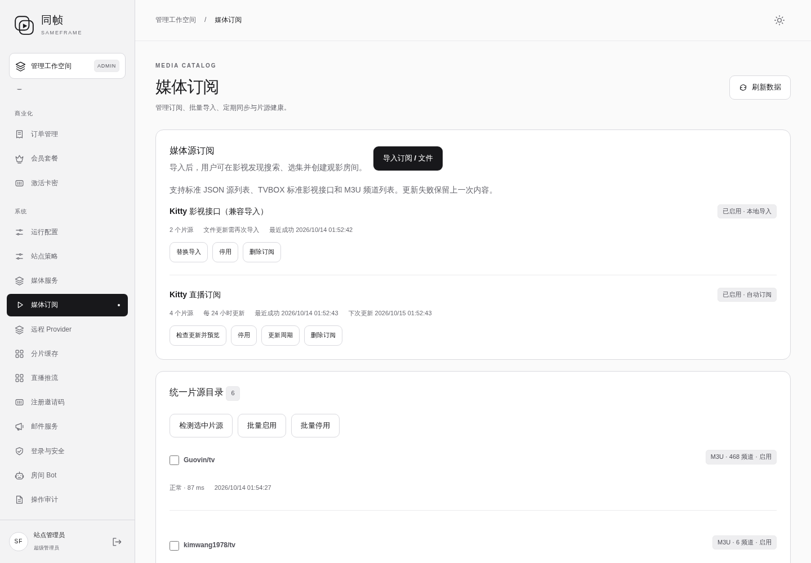
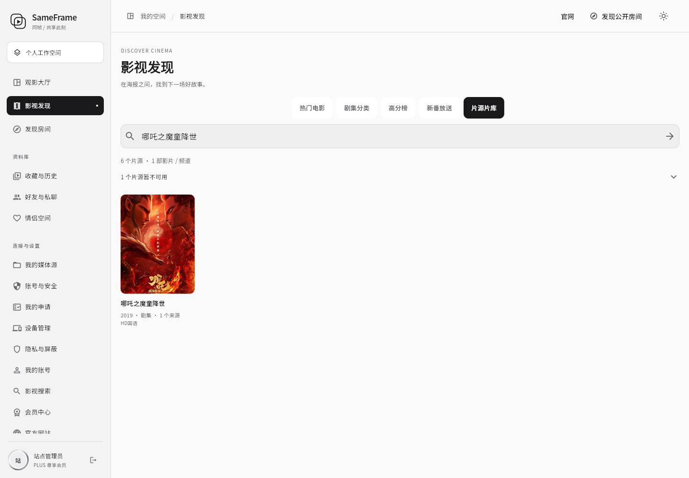

# Kitty 源导入及新增订阅格式检查

状态：配置已导入；两个影视来源因正式环境播放 403 已暂停启用，四份直播来源保留。程序版本未变化：后端 `f07becd`，启动脚本修复 `e6f1fd0`，变更前代码记录 `d4d05c5`。

## 新增与修改

- 新增“Kitty 影视接口（兼容导入）”，包含牛牛 JSON API 和转换为 JSON 地址的非凡 API。
- 新增“Kitty 直播订阅”，使用用户提供的 `https://d1y.github.io/kitty/lives.json`，每 24 小时更新。
- 合计两个订阅、六个独立片源，四份直播列表包含 1,014 个频道条目：vbskycn 519、Guovin 468、mytv-android 21、kimwang1978 6。
- 对抽查后返回 403 的两个影视源执行后台停用，保留配置以便后续更换 / 调整可用来源后重新启用。
- 导入预览跳过 12 个重复或无效条目；没有删除原有订阅，导入前目录为空。
- 非凡接口从 `/api.php/provide/vod/at/xml` 调整为 `/api.php/provide/vod`。这份影视配置是本地兼容导入；影片内容仍实时查询上游，配置地址变化需要重新导入。
- 未导入 Kitty `x.json` 的四个 JS 源。
- 没有修改应用程序、登录策略、主题或原有功能。本次不涉及新的程序构建 / 数据库迁移。

## 实测结果与限制

- 两个影视接口的列表探测成功；非凡关键词检索和详情读取成功。
- 牛牛上游关键词请求明确返回“暂不支持搜索”，包括 `ac=detail` / `ac=videolist` 两种请求，不能把它当作支持聚合检索的来源。
- 开发环境此前四个影视样本能读取清单与首片段；**正式服务器测试的非凡、牛牛视频地址返回 403，影视播放未通过正式环境验收**。导入成功、搜索成功不等于视频可以播放，未把这项标记为已完成。
- 广西卫视通过正式服务器的房间媒体代理读取两层 HLS 清单和首片段，状态 200 / 206。浏览器实播尝试没有达到解码播放验收条件，因此只确认清单 / 分片可读，没有宣称完整播放通过。
- 1,014 是成功导入的频道记录数，不是全量播放通过数；部分频道会超时、返回 403 或证书错误。
- 验收创建的临时房间均为私密房间，验证后移入回收站；未删除其他用户房间。

## 用户追加的七个地址

| 配置 | 当前读取结果 | 当前导入器兼容性 |
| --- | --- | --- |
| aiwex.json（安卓三代） | 99 个站点，全部 type=3 | 影视部分需要专用爬虫运行环境 |
| newwex.json（OK 影视牛二） | 与 aiwex 内容哈希一致 | 同上，不能当作另一套标准 API |
| wex.json（OK 影视凯速） | 63 个站点，全部 type=3 | 影视部分需要专用爬虫运行环境 |
| 猫爪 iOS 的 index.js.md5 | 32 位校验摘要 | 不是脚本或片源配置；测试使用了用户给的 Basic 凭据，记录中不保存凭据 |
| 魔力云播的 index.js.md5 | 同一个 32 位校验摘要 | 不是可导入列表 |
| 饭太硬 /tv | JPEG 包装 + Base64 + 含注释的配置；静态展开后 48 个 type=3 站点 | 解开数据包装仍需专用爬虫环境 |
| 肥猫 /tv | 第 124 行 ext 字段缺少引号，严格 JSON 无法解析；只为检查修正该字符后为 39 个 type=3 站点 | 配置需要修复，影视仍需专用运行环境 |

凯速配置中的 Kimentanm 直播链接可读取标准 M3U，含 120 个条目，可单独整理为直播订阅；另一直播地址返回的 M3U 没有频道条目。没有把这批新增链接导入生产，也没有执行下载的 JS / JAR。静态数据解码不等于播放器兼容。

## 备份与撤销

- 备份目录：`/opt/sameframe/backups/kitty-sources-20261014-014950/`。
- 数据库备份 SHA-256：`34d2ff5777d936abb88122804867699a1932aa0aa2b98f83fc64ab4b61773d33`。
- 加密目录快照 SHA-256：`37517e5f3dc66819f61f5a7bb8ace1921282415f10551d2defa5c3eb0985b570`。
- 操作清单：`/opt/sameframe/releases/kitty-sources-20261014-014950/operation.json`。
- 新建订阅 ID：`l4pPCp7spwXfjaXR`、`xIZjg58LzBOMtEq9`。
- 撤销预览已验证，只删除这两个订阅，保留后续用户和其他配置；不要恢复旧数据库。

```sh
# 只查看撤销范围
python3 /opt/sameframe/releases/kitty-sources-20261014-014950/rollback.py

# 确认撤销本次导入
python3 /opt/sameframe/releases/kitty-sources-20261014-014950/rollback.py --apply
```

源码版本不变，因此没有重复构建或重新部署应用。外部源可用性以检查时的网络与上游状态为准。


## 检查记录

- [导入与回滚清单](validation/2026-10-14-kitty-import-operation.json)
- [最终后台状态](validation/2026-10-14-kitty-final-catalog.json)
- [媒体代理检查](validation/2026-10-14-kitty-proxy-validation.json)
- [浏览器尝试与临时房间清理](validation/2026-10-14-kitty-browser-attempt.json)
- [新增七个链接的静态检查](validation/2026-10-14-additional-source-assessment.json)




